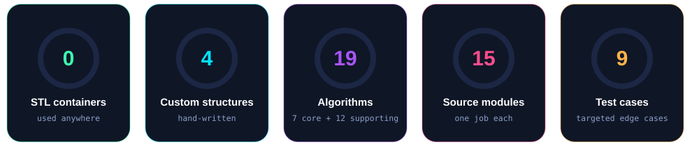
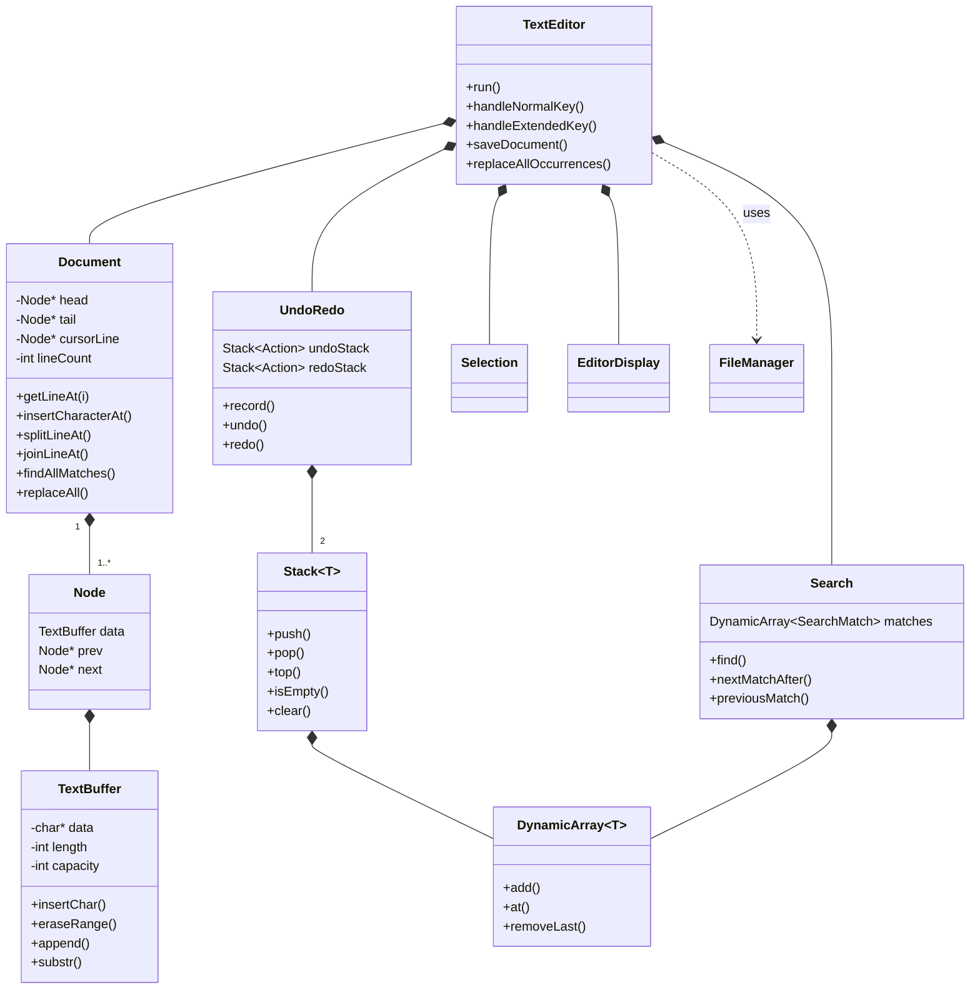
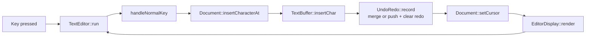
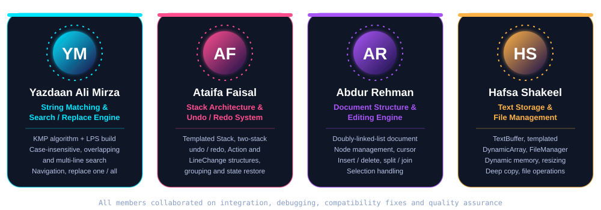

<div align="center">



<br/>


### A fast, keyboard-driven console text editor where **every data structure is hand-written**.
**Doubly linked list · Dynamic arrays · Two-stack Undo/Redo · KMP search · Binary search**

<br/>

[**Overview**](#overview) ·
[**Features**](#features) ·
[**Architecture**](#architecture) ·
[**Algorithms**](#algorithms) ·
[**Shortcuts**](#shortcuts) ·
[**Getting Started**](#getting-started) ·
[**Team**](#team)

</div>


<a id="overview"></a>


This project is our **CS-218 Data Structures and Algorithms Complex Engineering Problem** at **NED University of Engineering and Technology, Karachi**. The goal was never a flashy interface. The goal was to **choose the right data structure for every job**, implement it ourselves, and **prove with complexity analysis** why the choice is good.

> **No `std::string`. No `std::vector`. No `std::list`. No `std::stack`.**
> Every container in this editor is our own code.

The editor keeps the whole document in memory and lets you create, open, edit, search, replace and save plain text, with full **Undo / Redo**, multi-line selection, and a smart search engine that can even match phrases across line breaks.




<a id="features"></a>




<details>
<summary><b>📋 Full feature list (text version)</b></summary>

<br/>

<table>
<tr>
<td width="50%" valign="top">

### 📝 Editing
- Insert text at any cursor position
- Enter splits a line, Backspace at column 0 joins lines
- Delete characters, words, ranges, or entire multi-line selections
- **Shift + Arrow** selection with inverted-colour highlighting
- Merge another file into the current document at the cursor

### 💾 Files
- Create, open, save and **Save As**
- Overwrite confirmation before replacing a different file
- Strict file-name validation (`.txt` only, no paths, no illegal characters)
- Everything lives in an auto-created `TextEditorFiles/` folder

</td>
<td width="50%" valign="top">

### 🔍 Search & Replace
- **Case-insensitive** search
- **KMP** for single words, finds **overlapping** matches
- **Flexible matching** for phrases and line breaks (a space matches a line break)
- Match list with `Match n: Line x, Column y`
- Jump to next match in **Θ(log k)** with binary search
- **Replace One** (pick the occurrence) and **Replace All** (one undo step)

### ↩️ Undo / Redo
- Stack-based, unlimited history
- Typing is **merged**: one `Ctrl+Z` removes a whole word
- Covers insert, delete, split, join, merge, range delete, replace

</td>
</tr>
<tr>
<td colspan="2" valign="top">

### 🖥️ Console UI
Numbered lines · vertical and horizontal scrolling · live header showing **line, column, total lines and characters** · shortcut footer · search-match highlighting that spans multiple lines · clean separation between display and data logic.

</td>
</tr>
</table>

</details>


<!--
<a id="demo"></a>


<div align="center">
  
</div>


-->

<a id="architecture"></a>


The program is split into **15 source files, one per module**. `main.cpp` includes the rest in dependency order, so the project builds as a single unit. Each class has exactly one job.



| Class | Responsibility |
|---|---|
| `TextBuffer` | Our own string: growing `char` array with insert, erase, append, substring |
| `DynamicArray<T>` | Our own vector: starts at 8 slots, **doubles** when full |
| `Stack<T>` | LIFO built on `DynamicArray<T>` |
| `Node` | One line of text plus `prev` / `next` pointers |
| `Document` | The linked list of lines, the cursor, editing, KMP and flexible search |
| `Action` | One undoable edit: type, position, text, cursor before/after |
| `UndoRedo` | Two stacks, `undo()`, `redo()`, and typing-merge in `record()` |
| `Search` | Last term, sorted match list, current match, binary-search navigation |
| `Selection` | Anchor point and range normalisation |
| `FileManager` | Open, save, file-name validation |
| `EditorDisplay` | Header, rows, footer, scrolling, highlighting. **Never mutates the document** |
| `TextEditor` | Main loop: reads keys and orchestrates everything |

### ⌨️ What happens when you press a key




<a id="data-structures"></a>


Every structure was chosen for the operation that matters most.

| Need | Structure | Why it fits | Rejected alternative |
|---|---|---|---|
| Many lines, frequent split / join | **Doubly linked list** | Split and join only change pointers. No shifting. Walk in both directions | Array of lines: every Enter shifts all lines below, **Θ(n)** |
| Text of one line, edited by index | **Dynamic char array** | **Θ(1)** index access, amortised **Θ(1)** append, compact | Linked list of chars: pointer per character, slow indexing |
| Undo / Redo | **Stack × 2** | Undo order is exactly LIFO. push / pop are **Θ(1)** | Queue or list: wrong order or more complex |
| Search results | **Dynamic array** | Sorted matches allow **binary search** and Θ(1) access by index | Linked list: no direct indexing, no binary search |

<details>
<summary><b>📐 Linked-list layout and split/join mechanics</b></summary>

```
 head                      cursorLine                    tail
  │                            │                          │
  ▼                            ▼                          ▼
┌──────────┐   next    ┌──────────────┐   next    ┌──────────┐
│ "Hello"  │ ────────► │   "World"    │ ────────► │   ""     │ ──► null
│  line 0  │ ◄──────── │    line 1    │ ◄──────── │  line 2  │
└──────────┘   prev    └──────────────┘   prev    └──────────┘
                     cursorIndex = 1, cursorColumn = 3

 Enter at column 5 of "HelloWorld"   ──►  splitLineAt(0, 5)  ──►  "Hello" ⇄ "World"   (new node, 4 pointers)
 Backspace at column 0 of "World"      ──►  joinLineAt(...)   ──►  append, unlink, delete node
```

The cursor stores its **node pointer, line number and column**, so "which line am I on?" is **Θ(1)**.

</details>

<details>
<summary><b>📦 TextBuffer memory layout</b></summary>

```
capacity 16, length 5   (17 slots: 16 characters + '\0')
┌───┬───┬───┬───┬───┬────┬───┬───┬───┬───┬───┐
│ H │ e │ l │ l │ o │ \0 │   │   │   │ … │   │
└───┴───┴───┴───┴───┴────┴───┴───┴───┴───┴───┘
```

When `length == capacity`, a new array of **2× capacity** (minimum 16) is allocated with `new (nothrow)`, characters are copied, and the old array is freed. This gives **amortised Θ(1) appends**. A trailing `'\0'` is always kept so lines print like normal C strings.

</details>

<details>
<summary><b>🔁 Two-stack Undo / Redo</b></summary>

```
        undoStack                                   redoStack
   ┌───────────────────┐   Ctrl+Z  pop → reverse → push   ┌───────────────────┐
   │ TYPED_TEXT "hello"│ ───────────────────────────────► │ MERGE_TEXT        │
   │ DELETE_RANGE      │ ◄─────────────────────────────── │ REPLACE_TEXT      │
   │ SPLIT_LINE        │   Ctrl+Y  pop → repeat → push    └───────────────────┘
   │ INSERT_CHAR 'a'   │
   └───────────────────┘
   New edit ⇒ record() pushes to undoStack and CLEARS redoStack
```

**Typing merge:** a typed letter joins the top action when it starts exactly where that action ended and neither letter is a space. So `hello world` becomes `TYPED_TEXT "hello"`, `INSERT_CHAR ' '`, `TYPED_TEXT "world"`.

</details>


<a id="algorithms"></a>


| # | Algorithm | Where | Time |
|:-:|---|---|---|
| 1 | **KMP string search** | `buildLps()`, `kmpSearchLine()` | **Θ(N + m)** |
| 2 | **Binary search** (upper bound) | `Search::nextMatchAfter()` | **Θ(log k)** |
| 3 | **Stack (LIFO)** for undo / redo | `Stack<T>`, `UndoRedo` | **Θ(1)** push / pop |
| 4 | **Doubly linked list ops** | split, join, insert, free | **Θ(1)** per link change |
| 5 | **Dynamic array doubling** | `makeRoom()`, `grow()` | **Amortised Θ(1)** |
| 6 | **Nearest-start traversal** | `Document::getLineAt()` | **Θ(min(i, n−1−i, d))** |
| 7 | **Flexible brute-force matching** | `matchesFrom()`, `skipLineBreakGap()` | **Θ(N · m)** worst case |

### 🎯 KMP: why it finds overlapping matches

`buildLps()` precomputes, for every position of the pattern, the longest prefix that is also a suffix. For `abab` the table is `0 0 1 2`. On a mismatch the text pointer **never goes back**. After a full match the scan resumes from `lps[matched-1]`, so overlaps are kept.

```
Text:     A A A A A A          Pattern: AAA
Matches:  ▓▓▓                  → position 0
            ▓▓▓                → position 1
              ▓▓▓              → position 2
                ▓▓▓            → position 3     ⇒ 4 matches in "AAAAAA"
```

**Worst-case proof sketch:** the text pointer `i` increases at most N times. The pattern pointer `j` increases at most N times and every fallback strictly decreases it, so it can fall at most N times. Total moves ≤ **3N = Θ(N)**. With LPS construction: **Θ(N + m)**.

### 🧭 Nearest-start line lookup

`getLineAt(i)` starts from whichever is closest: **head**, **tail**, or the **cursor line**. Typing happens at the cursor, so the walk is usually **0 to a few steps**. The worst case is about **n/2**.

### 🔎 Binary search for the next match

The match list is sorted by `(line, column)`. `nextMatchAfter()` runs an **upper-bound** binary search and **wraps** to the first match if nothing is after the cursor. With matches on lines 2, 5, 9, 14 and the cursor on line 9, it lands on line 14 in about `log₂(4) = 2` comparisons.

### 🔀 Flexible matching

KMP cannot handle a space that may match a **line break plus surrounding whitespace**, because the match has no fixed length. `matchesFrom()` treats the document as one continuous text where each line end is one line-break character. A typed `\n` matches only a line break.

### 🔁 Replace All

1. Collect all matches.
2. Keep a **greedy, non-overlapping** subset (left to right).
3. Replace from the **end of the document to the start**, so earlier line/column positions stay valid.
4. Store every change in **one `Action`**, so a single `Ctrl+Z` undoes everything.

<details>
<summary><b>🛠️ Supporting techniques</b></summary>

| Technique | Where |
|---|---|
| Typing merge | `UndoRedo::record()` |
| Greedy non-overlapping selection | `Document::replaceAll()` |
| Right-to-left replacement | `Document::replaceAll()` |
| Array element shifting | `insertChar()`, `eraseRange()` |
| Linear scan and `\n` splitting | `splitLines()`, `linesToText()`, `unescapeLineBreaks()` |
| Circular (wrap-around) indexing | `nextMatchAfter()`, `previousMatch()` |
| Range normalisation | `Selection::getRange()` |
| Integer to text (`% 10`, written backwards) | `TextBuffer::appendNumber()` |
| Build new copy first, then free old | `replaceLines()`, `DynamicArray::operator=` |
| Viewport scrolling arithmetic | `EditorDisplay::render()`, `getHorizontalOffset()` |

</details>


<a id="complexity"></a>


**Symbols:** `n` lines · `L` line length · `N` total characters · `m` search length · `k` matches · `r` lines touched · `s` text size · `d` distance from cursor

| Operation | Time |
|---|---|
| Append one char to `TextBuffer` | Θ(1) amortised |
| `insertChar` / `eraseRange` | Θ(L) |
| `DynamicArray` add / `Stack` push | Θ(1) amortised |
| `Stack` pop / top / isEmpty / clear | Θ(1) |
| `getLineCount`, `getCursorLineIndex` | Θ(1) |
| `getLineAt(i)` | Θ(min(i, n−1−i, d)), at most n/2 |
| Type a character | Θ(L) |
| Delete a character | Θ(L) |
| Split / join a line | Θ(L) |
| Delete selection / insert text / merge | Θ(r · L + s) |
| Build LPS table | Θ(m) |
| Search without space (KMP) | **Θ(N + m)** |
| Search with space or line break | Θ(N · m) worst case, usually near Θ(N) |
| Next match | Θ(log k) + `getLineAt` |
| Replace All | search + Θ(k · (L + m + `getLineAt`)) |
| Save / Open file | Θ(N) |

**Space:** document Θ(N) + Θ(n) nodes · undo/redo grows with the number of edits · search Θ(k) + Θ(m).


<a id="shortcuts"></a>


| Action | Key |
|---|---|
| Save | `Ctrl` + `S` |
| Save As | `Ctrl` + `A` |
| Merge a file at the cursor | `Ctrl` + `O` |
| Search | `Ctrl` + `F2` · `F2` · `Ctrl` + `Space` |
| List all search results | `F4` |
| Next match | `F3` · `Ctrl` + `N` |
| Replace one occurrence | `F8` |
| Replace all occurrences | `F7` |
| Undo / Redo | `Ctrl` + `Z` / `Ctrl` + `Y` |
| Select text | `Shift` + `Arrow keys` |
| Delete character / selection | `Delete` · `Backspace` |
| New line | `Enter` |
| Move cursor | `Arrow keys` · `Home` · `End` |
| Back to menu | `Esc` |


<a id="getting-started"></a>


### Requirements
- **Windows** (uses `conio.h` and `windows.h`)
- A C++ compiler: **MinGW-w64 g++**, **MSVC**, or **Clang**
- Any modern terminal (Windows Terminal or CMD recommended, with a reasonably large window)

### Build and run

```bash
# 1. Clone
git clone https://github.com/AtaifaFaisal87/<your-repo>.git
cd <your-repo>

# 2. Compile (main.cpp includes every module, so it builds as one unit)
g++ -std=c++17 -O2 main.cpp -o TextEditor.exe

# 3. Run
./TextEditor.exe
```

**Visual Studio:** open the folder, add `main.cpp` to a new Console project, and build in Release mode.

### First steps

1. Pick **1** to start a new document, **2** to open a `.txt` file, or **3** to exit.
2. Type, use arrow keys to move, `Shift` + arrows to select.
3. `Ctrl` + `S` to save. Files are stored in `TextEditorFiles/`.


<a id="error-handling"></a>


The editor reports bad input instead of crashing.

| Situation | Behaviour |
|---|---|
| Open a missing file | `ERROR: FILE NOT FOUND!`, back to the menu, document unchanged |
| Name without `.txt` | `ERROR: INVALID FILE EXTENSION. ONLY .txt FILES ARE ALLOWED.` |
| Path or illegal characters in name | `ERROR: INVALID FILENAME. ENTER A NAME, NOT A PATH.` |
| New document with a name already used | `ERROR: FILE NAME ALREADY USED. PLEASE ENTER A UNIQUE NAME.` |
| Save As over a different file | Asks `Replace this file? (Y/N)` |
| File cannot be written | `ERROR: DOCUMENT COULD NOT BE SAVED` |
| Out of memory | `new (nothrow)` returns `nullptr`, edit is skipped, old document stays |
| Empty search term | `SEARCH CANCELLED - EMPTY SEARCH TERM` |
| No matches | `NO MATCHES FOUND: <term>` |
| Undo / Redo with empty stack | `pop()` returns `false`, nothing happens |
| Invalid line or index | `getLineAt()` returns `nullptr`, `charAt()` returns `'\0'` |
| Console too small | `render()` skips drawing instead of writing out of bounds |

**Memory rules:** every class that calls `new[]` frees it in its destructor. `TextBuffer` and `DynamicArray` implement **deep-copy** constructors and `operator=`. `Document` and `TextEditor` are **non-copyable** (`= delete`) to prevent double-free.


<a id="testing"></a>


Nine targeted test cases, each aimed at a feature that is hard to get right.

| ID | Test | Expected result |
|:-:|---|---|
| **T1** | Overlapping KMP matches | `AAA` in `AAAA / AAAAAA / AAA` → **7 matches** (2 + 4 + 1) |
| **T2** | Multi-line search | `"were challenging"` found across a line break, highlighted on both lines |
| **T3** | Case-insensitive search | `the` matches `the` and `The` → **93 matches** in the test document |
| **T4** | Multi-line selection + delete | Only the selected range is removed; 218 → **42 characters** |
| **T5** | Undo / redo after range delete | `Ctrl+Z` restores all 3 lines, `Ctrl+Y` reapplies the delete |
| **T6** | Replace All + undo / redo | `ABC ABC ABC` → `XYZ XYZ XYZ`, undone and redone in **one step** |
| **T7** | Merge + extension validation | `covalent.doc` rejected, `covalent bonds.txt` merged and undoable |
| **T8** | Long-line scrolling | 467-character line scrolls horizontally with nothing lost |
| **T9** | Large document | **2,517-line** file opens, scrolls to the end, finds the last line |


<a id="roadmap"></a>


- [ ] **Cross-platform input/rendering** layer (currently Windows only)
- [ ] **Linear-time phrase search** using Shift-And or a DFA instead of brute force
- [ ] **Gap buffer / rope** and a stored character count to avoid Θ(n) far-line lookups and per-redraw counting
- [ ] **Bounded undo history**
- [ ] Keep matches valid after edits instead of clearing the list
- [ ] Assign a key to `previousMatch()`
- [ ] **Unsaved-changes warning** on `Esc`
- [ ] Tab and non-ASCII character support
- [ ] Go-to-line, Page Up / Page Down, whole-word and case-sensitive search options


<a id="team"></a>


<div align="center">

**Department of Computer and Information Systems Engineering**
**NED University of Engineering and Technology, Karachi · CS-218 · Fall Semester 2026**



</div>


<a id="license"></a>


This project is licensed under the **MIT License**.

<details>
<summary><b>Read the full license text</b></summary>

```text
MIT License

Copyright (c) 2026 Yazdaan Ali Mirza, Ataifa Faisal, Abdur Rehman, Hafsa Shakeel

Permission is hereby granted, free of charge, to any person obtaining a copy
of this software and associated documentation files (the "Software"), to deal
in the Software without restriction, including without limitation the rights
to use, copy, modify, merge, publish, distribute, sublicense, and/or sell
copies of the Software, and to permit persons to whom the Software is
furnished to do so, subject to the following conditions:

The above copyright notice and this permission notice shall be included in all
copies or substantial portions of the Software.

THE SOFTWARE IS PROVIDED "AS IS", WITHOUT WARRANTY OF ANY KIND, EXPRESS OR
IMPLIED, INCLUDING BUT NOT LIMITED TO THE WARRANTIES OF MERCHANTABILITY,
FITNESS FOR A PARTICULAR PURPOSE AND NONINFRINGEMENT. IN NO EVENT SHALL THE
AUTHORS OR COPYRIGHT HOLDERS BE LIABLE FOR ANY CLAIM, DAMAGES OR OTHER
LIABILITY, WHETHER IN AN ACTION OF CONTRACT, TORT OR OTHERWISE, ARISING FROM,
OUT OF OR IN CONNECTION WITH THE SOFTWARE OR THE USE OR OTHER DEALINGS IN THE
SOFTWARE.
```

</details>


<div align="center">

**Built with ☕, pointers, and a refusal to `#include <vector>`.**

</div>
